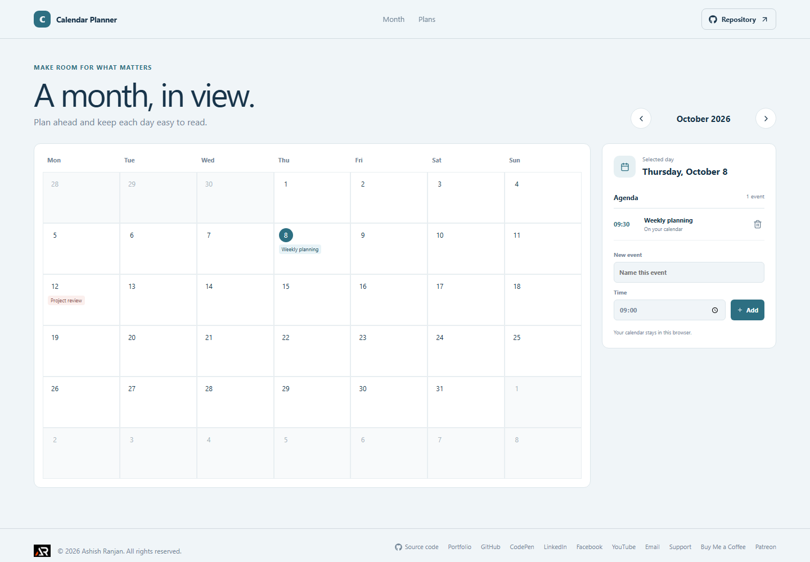

# Calendar Planner

Calendar Planner is a personal month view for placing appointments and seeing the shape of upcoming days.

## Interface

The interface has a six-week calendar grid, previous and next month controls, and a selected-day agenda. Events appear in their date cells and in time order in the agenda.

## Features and use

Move between months, select any visible date, and add an event with a title and time. Remove an event after reviewing the confirmation. The selected date and visible month update as you move through the calendar.

## Data and limits

Events are saved in localStorage in this browser. The calendar has no server connection, invitations, recurring-event rules, or synchronization. Clearing local browser storage removes saved events.

## Run locally

Use Node.js and npm, then run these commands from the project folder:

```sh
npm install
npm run dev
```

The app is built with React and Vite. Check the source and production build with:

```sh
npm run lint
npm run build
```

## Deployment

The public app is published with GitHub Pages at [https://a2rp.github.io/calendar-planner/](https://a2rp.github.io/calendar-planner/). To build and publish the current version, run:

```sh
npm run deploy
```

## Future improvements

Ideas that are not implemented yet:

- Recurring events, calendar-file import and export, and shared calendars.

## Links

- Portfolio: [https://www.ashishranjan.net](https://www.ashishranjan.net)
- GitHub: [https://github.com/a2rp](https://github.com/a2rp)
- CodePen: [https://codepen.io/ash1198](https://codepen.io/ash1198)
- LinkedIn: [https://www.linkedin.com/in/aashishranjan](https://www.linkedin.com/in/aashishranjan)
- Facebook: [https://www.facebook.com/theash.ashish/](https://www.facebook.com/theash.ashish/)
- YouTube: [https://www.youtube.com/@ashishranjan-ashz?sub_confirmation=1](https://www.youtube.com/@ashishranjan-ashz?sub_confirmation=1)
- Email: [mailto:ash.ranjan09@gmail.com](mailto:ash.ranjan09@gmail.com)

## Support

- Support: [https://a2rp-donation-page.netlify.app/](https://a2rp-donation-page.netlify.app/)
- Buy Me a Coffee: [https://buymeacoffee.com/ashishranjan](https://buymeacoffee.com/ashishranjan)
- Patreon: [https://www.patreon.com/ashishranjan](https://www.patreon.com/ashishranjan)